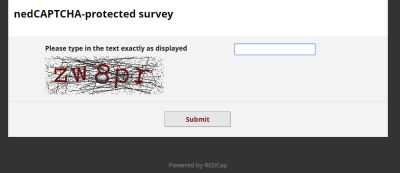

# nedCAPTCHA 2 (REDCap External Module)

[](https://doi.org/10.5281/zenodo.20492803)

nedCAPTCHA 2 adds CAPTCHA protection to REDCap public surveys without depending on an external CAPTCHA provider. The name stands for **n**o **e**xternal **d**ependencies.

Release metadata is prepared for **1.1.4**, with a planned release date of **2026-11-17**. See the [release validation results](#114-release-readiness).

This is a new version of [nedCAPTCHA](https://github.com/grezniczek/redcap_nedcaptcha). It uses action-tagged fields on the first survey page instead of a fixed module-level CAPTCHA page, which allows more project-specific layout, field embedding, and compatibility with REDCap Multi-Language Management.

## Purpose

REDCap 8.11.0 and newer can use Google reCAPTCHA, but that is not always suitable for servers with restrictive firewall rules, strict privacy requirements, or policies that prohibit sharing respondent IP addresses with a third-party CAPTCHA service. nedCAPTCHA 2 keeps the challenge generation inside REDCap/PHP.

## Effect

When the module is enabled in a project and an instrument's first public survey page contains an `@NEDCAPTCHA` field, respondents must solve the configured challenge before the normal first survey page is shown. The module supports:

- a simple or complex math problem,
- a distorted text image,
- a custom challenge-response list, or
- a disabled `none` mode that leaves the tagged fields out of normal survey operation without presenting a challenge.

In longitudinal projects, the CAPTCHA applies to the public link for each eligible arm. Each link has its own challenge proof. Individual participant links remain under REDCap’s control.

The module stores transient CAPTCHA state in the External Modules log and binds each challenge to the browser's REDCap survey session. Challenge proof expires 120 minutes after issuance; an hourly cron removes expired log entries. CAPTCHA responses are not saved to the project data unless the **Capture response** option is enabled.



The custom challenge type can also be used as lightweight public-survey password protection by configuring one challenge such as `Type the access key to proceed. = secretaccesskey`. This applies to normal public entry; REDCap's individual-link workflows remain governed by REDCap.

## Requirements

- REDCap 15.5.0 or newer.
- REDCap External Modules Framework 16 or newer.
- Browser cookies that allow REDCap's survey session to persist across requests.
- PHP GD with FreeType support for image rendering. If image rendering is unavailable, the module uses a plain-text math puzzle.

## Installation

- Clone this repository into `<redcap-root>/modules/nedcaptcha2_v<version-number>`, or install it from the REDCap Consortium External Modules Repo when available.
- For a development checkout, retain the directory name `nedcaptcha2_v9.9.9`; this directory convention is independent of published release versions.
- In REDCap, go to _Control Center > Technical / Developer Tools > External Modules_ and enable **nedCAPTCHA 2**.
- Enable the module in projects that need public survey CAPTCHA protection.

An importable REDCap demo project is available at [example/Demo_nedCAPTCHA2.REDCap.xml](example/Demo_nedCAPTCHA2.REDCap.xml).

## Configuration

There are no system-level settings besides the standard External Modules Framework controls.

Project-level settings:

- **Debug mode:** Available to super users. When enabled, nedCAPTCHA 2 prints diagnostic information to the browser console and includes the answer in math challenges for troubleshooting.
- **Allow solved CAPTCHA sessions:** When enabled, a browser that has solved the CAPTCHA may reuse that solved state for the same project's public survey without solving again in a new tab.
- **Solved CAPTCHA session timeout:** Number of minutes a solved session remains valid. The default is 120 minutes. Use `0` for no configured timeout; sessions are still capped at 24 hours and expire after 2 hours without refresh.

All CAPTCHA behavior is configured through the `@NEDCAPTCHA` action tag. In the Online Designer, click the `@NEDCAPTCHA` action tag on the field list to open the nedCAPTCHA Editor. Manual JSON editing is possible, but the editor is the recommended way to maintain settings. The JSON configuration format is described by [schema/nedcaptcha-action-tag.schema.json](schema/nedcaptcha-action-tag.schema.json).

A bare `@NEDCAPTCHA` action tag uses the default math CAPTCHA on the survey and opens the editor with **Math Problem** selected.

The editor requires design rights. In production projects, configuration changes require editable draft mode and are written to draft metadata. Successful changes are recorded in the REDCap project log with the field, metadata table, and before/after configuration; custom responses are redacted because they may be access keys.

Save errors and warnings appear inside the editor. Successful saves use a module-owned notice instead of REDCap's shared Bootstrap toast helper. If settings are edited while a save is pending, the editor keeps the later changes open and requests another Update.

If loading settings fails because design rights or editable draft mode have changed, the editor shows the server's explanation in a closeable error dialog with no Update button. Failed requests and malformed replies also show an error instead of an empty editor. Resolve the issue and reload the Online Designer before trying again. Recoverable configuration warnings appear alongside valid settings so they can be corrected and saved.


## Basic Setup

1. Put a Text Box field with no validation on the first page of the public survey instrument. If all questions are displayed on one page, the field can be in any section. If each section is displayed on a separate page, the field must be in the first section.
2. Add `@NEDCAPTCHA` to that field.
3. Use the field label as the prompt shown above the challenge.
4. Click the action tag in the Online Designer to configure the CAPTCHA type and options.
5. Consider adding `@HIDDEN-FORM` and `@HIDDEN-PDF` to fields used only for the CAPTCHA page, especially when the response is not captured.

The `@NEDCAPTCHA` field and other nedCAPTCHA helper fields are removed from normal survey operation after the respondent passes the CAPTCHA, or when the module determines that the current request is not the fresh public survey entry point.

## Action Tags

All nedCAPTCHA action tags are case-sensitive and must use the uppercase names shown below.

### `@NEDCAPTCHA`

Required to protect a public survey. Add it to one Text Box field without validation on the first survey page. The action tag accepts a JSON object containing the CAPTCHA configuration.

Only one `@NEDCAPTCHA` field should be used on a survey page.

Example math configuration:

```text
@NEDCAPTCHA={
  "type": "math",
  "complexity": "complex",
  "minValue": 2,
  "maxValue": 12,
  "showAsText": true
}
```

Example custom challenge-response configuration:

```text
@NEDCAPTCHA={
  "type": "custom",
  "caseInsensitive": true,
  "custom": [
    {
      "challenge": "The color of the sky?",
      "response": "blue"
    },
    {
      "challenge": "Type the access key to proceed.",
      "response": "secretaccesskey"
    }
  ]
}
```

### `@NEDCAPTCHA-INSTRUCTIONS`

Optional. Add it to a Descriptive Text field on the first survey page. While the CAPTCHA is shown, this field's label replaces the normal survey instructions. This is useful for custom intro text and for REDCap Multi-Language Management.

Only one `@NEDCAPTCHA-INSTRUCTIONS` field should be used.

### `@NEDCAPTCHA-FAILMESSAGE`

Optional. Add it to a Descriptive Text field on the first survey page. The field is hidden initially and shown only after an incorrect CAPTCHA response.

Only one `@NEDCAPTCHA-FAILMESSAGE` field should be used.

### `@NEDCAPTCHA-DISPLAY`

Optional. Add it to Descriptive Text fields on the first survey page that should remain visible while the CAPTCHA is presented. This can be used for logos, explanatory text, or other content that belongs on the CAPTCHA screen.

This tag may be used on multiple fields.

### `@NEDCAPTCHA-CUSTOM-CHALLENGE`

Optional and only relevant when the CAPTCHA type is `custom`. Add it to a Text Box field without validation on the first survey page. The module writes the selected custom challenge value into this field and triggers branching logic, which allows you to show custom fields or images based on the selected challenge.

Only one `@NEDCAPTCHA-CUSTOM-CHALLENGE` field should usually be used.

### `@NEDCAPTCHA-CUSTOM-EMBED`

Optional and only relevant when the CAPTCHA type is `custom`. Add it to a field on the first survey page with one string parameter matching a custom challenge value, for example:

```text
@NEDCAPTCHA-CUSTOM-EMBED="challenge_a"
```

When that challenge is selected, the matching field's label is embedded where the CAPTCHA challenge normally appears. Non-matching embed fields are excluded from the CAPTCHA page. Do not combine this tag with other nedCAPTCHA action tags on the same field.

This tag may be used on multiple fields.

## CAPTCHA Options

### Common Options

- **CAPTCHA Type:** `math`, `image`, `custom`, or `none`.
- **Capture response:** When enabled, the verified CAPTCHA response is stored in the `@NEDCAPTCHA` field when the first survey submission is saved, including Save & Return Later. The response is kept server-side until saving. By default, responses are not captured.

### Math Problem

- **Complexity:** `simple` uses addition. `complex` uses two operators selected from addition, subtraction, and multiplication. The generator avoids double multiplication and non-negative results are enforced.
- **Minimum / Maximum operand values:** Positive integer bounds for initially generated operands. The defaults are 1 and 10, and the minimum must not exceed the maximum. The editor rejects an inverted range; an existing hand-written inverted range is normalized to 1 through 10 at runtime. Subtraction problems can enlarge an operand to keep the result non-negative.
- **Show as text:** By default, math challenges are rendered as images. This option renders the math expression as text, which may improve accessibility for screen-reader users.
- **Background color / Text color:** Colors may be entered as HTML hex values such as `#ff0000` or as comma-separated RGB triplets such as `255,0,0`.

### Distorted Text Image

- **Length:** Number of characters in the generated challenge. The allowed range is 3 to 8 characters; the default is 5.
- **Re-use challenge:** By default, a new image challenge is created after an unsuccessful attempt. When enabled, the same challenge is reused for retries.
- **Angle variation:** `none`, `slight`, `medium`, or `strong`.
- **Size variation:** `none`, `slight`, `medium`, or `strong`.
- **Noise density:** `off`, `low`, `medium`, or `high`.
- **Background color / Text color / Noise color:** Colors may be entered as HTML hex values or comma-separated RGB triplets.

The image character set is optimized for readability and excludes visually ambiguous characters.

### Custom Challenge/Response

Enter one challenge-response pair per line, separated by `=`:

```text
The color of the sky? = blue
The color of grass? = green
Snow White and the __?__ dwarfs = seven
```

If a stored challenge contains an equals sign, or a pair contains line breaks or surrounding whitespace, the editor shows the pairs as a JSON list so their exact text can be edited. Changing another setting preserves the original pairs.

The module randomly selects one pair. Challenges are displayed as escaped plain text; use `@NEDCAPTCHA-CUSTOM-EMBED` with descriptive fields for formatted content or images. JSON string parameters for embedding keys are decoded, so escaped quotes, backslashes, and Unicode escapes can match the challenge text.

Leading and trailing whitespace is trimmed from responses. Otherwise, custom responses are compared as text: leading zeros are significant, and scientific-notation strings are not treated as equivalent numbers. By default, comparison is case-sensitive. Enable **Use case-insensitive comparison for responses** to accept answers regardless of case. The custom helper fields are optional.

## Styling

The module injects a small number of wrapper elements that can be targeted from custom survey CSS:

- Instructions from `@NEDCAPTCHA-INSTRUCTIONS` are wrapped in `#nedcaptcha2-instructions`.
- Challenges are wrapped in `.nedcaptcha2-challenge`.
- Failed responses cause the response input to receive a red outline and an inline warning icon.

For example:

```css
#nedcaptcha2-instructions {
  margin-bottom: 1rem;
}

.nedcaptcha2-challenge {
  font-size: 1.2rem;
}
```

## Notes and Limitations

- The module is intended for the first page of a fresh public survey. It does not protect data-entry forms, authenticated survey links tied to existing records, returning surveys, survey queue passthroughs, or end-of-survey/return-code flows.
- REDCap's private-link workflows, including participant-link issuance, are outside the intended CAPTCHA scope. A link issued by REDCap is handled as an individual survey link; nedCAPTCHA does not provide an access-control boundary around REDCap's issuance of such links.
- Calculated fields are not evaluated while the CAPTCHA-only page is displayed. Normal calculation behavior resumes after the CAPTCHA is passed. Branching logic remains available for `@NEDCAPTCHA-CUSTOM-CHALLENGE`; logic used on the CAPTCHA-only page should reference fields retained on that page.
- The Save & Return Later button is hidden while the CAPTCHA is being presented.
- Hidden REDCap fields, except the CSRF token and nedCAPTCHA's own temporary client key, are removed from the CAPTCHA form before submission.
- CAPTCHA proof is bound to the browser's REDCap survey session, expires after two hours, and is consumed through the save-record hook when the first survey submission is saved. The proof expires from challenge issuance, rather than from the last edit to the survey form. Later pages and resumed responses rely on REDCap's response hashes, private survey links, and return-code authentication.
- If proof expires or the session is lost before the first submission, eligible first-page answers are held temporarily in the browser's current server-side survey session while a new CAPTCHA is presented. Solving it resumes the original submission through REDCap's normal validation and saving, including Save & Return Later and confirmed Stop Actions. A recovered Stop Action is checked against the selected choice and the current field configuration. REDCap then applies the survey’s setting to save or discard the response. Held answers are removed after saving or after two hours; the recovery session must persist during re-verification. Answers are not included in the CAPTCHA HTML or persistent module logs.
- If REDCap's native upload context is also lost, solving the CAPTCHA restores the other answers to the form and highlights files that must be uploaded again. Nothing is saved automatically in that case; upload the files again and submit or choose Save & Return Later. Uploaded files remain usable after proof expiry when their native upload context is still valid.
- After the CAPTCHA is solved, helper fields are excluded consistently from the displayed survey, submissions, and Save & Return requests so that page numbering stays the same. Captured responses are saved separately through REDCap's data API; a capture failure is logged without interrupting the survey save.
- Custom challenges and responses must be nonblank strings. The survey skips invalid pairs and falls back to math if none remain. Invalid colors use the default for that color and produce a warning.
- Unparseable action-tag parameters and missing or invalid CAPTCHA types fall back to a math challenge, with a diagnostic warning. Disabling protection requires the explicit configuration `"type": "none"`. The editor opens recognizable malformed assignments with math defaults and replaces the whole value on Update. If unfinished quotes or surrounding notes make the end of the assignment unclear, correct it in the field annotation; the editor explains the problem and leaves the annotation intact. Invalid editor submissions are rejected without changing metadata.
- If CAPTCHA generation or image rendering fails, the module falls back to a plain-text math puzzle so that respondents can still reach the survey.
- Solved CAPTCHA sessions are disabled by default. When disabled, opening the same public survey in a new tab requires solving the CAPTCHA again.
- When solved CAPTCHA sessions are enabled, the solved state is stored as an opaque browser cookie backed by server-side session metadata. It applies only to the same browser and the same project public survey.

### 1.1.4 Release Readiness

The issues identified in the code review on 2026-11-16 have been corrected and covered by automated checks on PHP 8.4.22, including pagination checks using the local REDCap survey class. Browser validation was performed on 2026-11-17 using the local REDCap 17.6.1 development installation, headless Chromium 159, and disposable project 562. The checks exercised REDCap's actual survey validation and persistence pipeline and verified saved answers in the database.

| Browser coverage | Result |
| --- | --- |
| Single-page and paginated surveys; normal submission and Save & Return Later; intact proof, expired proof, and lost survey session | Passed all 12 combinations; incorrect recovery answers remained blocked and no response was saved before re-verification. |
| Challenge types and discovery | Image, bare/simple math, complex math, and custom challenges passed. Invalid JSON and invalid types remained protected by math; explicit `none` skipped the challenge. A later-section tag protected a single-page survey and remained outside the supported first-page scope when pagination was enabled. |
| Saved responses and continuation | Text, numeric, radio, checkbox, date, Unicode, and multiline answers retained; Next/Previous, return-code entry in a fresh browser session, repeated Save & Return, and completion passed. |
| Native server validation | Invalid numeric submissions redisplayed the normal survey with the other answers retained; correcting the value saved successfully, including after proof expiry and session loss. |
| Native file uploads in both layouts and with both submission actions | Valid upload contexts retained files after proof expiry. Lost contexts restored the other answers and displayed a re-upload notice; uploading again and saving passed. |
| Authenticated editor | User confirmed normal loading, changing Re-use challenge, saving and reopening, and restoring the original value. |
| Editor permission and draft errors | Visible errors and Cancel-only dialogs passed with the native jQuery UI widget and simulated server replies; the PHP permission/draft guards are covered by the automated suite. |

Browser testing found and corrected silent attachment loss after survey-session loss. Regression tests cover retaining owned upload contexts, returning a filled form for unowned contexts, and saving a replacement upload. Project annotations and pagination were restored after testing; synthetic responses and attachments remain in project 562 for inspection. These results cover this local installation and Chromium; other REDCap installations and browsers were not exercised.

### Development Checks

Install JavaScript test dependencies with `npm ci`, then run `npm test`. PHP with GD, PNG, and FreeType support and Node.js 18 or newer are needed for the full suite; Node.js and the npm packages are not runtime dependencies of the external module. The image-rendering tests require working GD, while separate checks disable image creation to verify the module's text-math fallback.

The suite covers editor saves and notices, in-memory survey-hook requests, invalid-configuration recovery and editor repair, and text-math fallback with image creation disabled, including a final fallback when random-number generation is disabled. Invalid-configuration checks verify that incorrect answers remain blocked, correct math answers unlock the survey, and explicit disabled mode remains available. Pagination regressions cover discovery in the first and later sections with pagination enabled or disabled, helper fields across sections on single-page surveys, separate/shared CAPTCHA sections, Next/Previous, validation redisplay, Save & Return from either page, return-code continuation, optional response capture, repeating instances, and capture failures.

Editor load checks cover design-rights and draft-mode failures, rejected requests, malformed/legacy replies, text-safe messages, duplicate opens during a pending load, closing and reopening after a failure, and editing valid settings accompanied by warnings.

Run `php tests/rendering.php` separately to verify image generation with every PHP diagnostic, including precision-loss deprecations, treated as an error. These checks decode the generated PNGs and verify nonblank content, dimensions, unchanged challenge types, and reused answers. They cover simple/complex math images and distorted images at every allowed length, angle variation, size variation, and noise density.

Submission recovery checks cover normal submissions and Save & Return after proof expiry, session loss, or missing log state on single-page and paginated surveys, with response capture enabled or disabled. They also cover checkbox controls, blank/zero/multiline values, native upload and validation context, incorrect answers, browser/tab isolation, proof rotation, buffer expiration and consumption, unsafe control filtering, math challenges, retry before saving, and capture failures. Eight additional upload-recovery cases cover owned and lost native upload contexts with both submission actions and pagination settings, including checkbox prefill and preserving the verified CAPTCHA response until the replacement upload is saved.

To exercise the pagination cases with a local REDCap installation's actual `Survey::getPageFields()` and `Survey::setPageNum()` methods, run `REDCAP_SURVEY_CLASS=/path/to/redcap/Classes/Survey.php php tests/pagination.php`. Database access and record saves remain in-memory doubles; these checks do not execute REDCap's full browser, validation, or persistence pipeline.

## Changelog

Version | Changes
------- | -----------
1.1.4 (planned: 2026-11-17) | Fixed saving settings for bare `@NEDCAPTCHA` tags and kept their default math behavior. Enforced case-sensitive module tags. Replaced shared editor toasts and preserved edits made during saves. Displayed editor load errors and configuration warnings. Escaped dynamic output, validated operand ranges, compared custom answers literally, decoded embedding keys, and made custom helper fields optional. Added design-rights and editable-draft checks plus redacted configuration audit events. Added text-math rendering fallback and browser-bound submission proof. Matched CAPTCHA discovery to the survey's pagination setting. Made invalid parameters and CAPTCHA types fall back to math instead of disabling protection. Preserved first-page submissions across proof expiry or session loss, including Save & Return Later. Kept page numbering consistent across submissions and Save & Return while saving captured responses separately. Fixed GD precision-loss deprecations so image rendering does not unnecessarily fall back to text math. Prevented silent attachment loss after survey-session loss by restoring the other answers and requesting re-upload before saving. Added automated regression checks and validated public-survey recovery, Save & Return, file uploads, and editor behavior through local REDCap browser tests.
1.1.3   | Prevented REDCap calculation JavaScript from running against fields removed from the CAPTCHA-only survey page while retaining branching logic for custom challenges.
1.1.2   | Removed "Test" link (development artifact).
1.1.1   | Minor code refactor.
1.1.0   | New feature: Configurable solved CAPTCHA sessions.<br>Minor PHP 8.5 compatibility fixes.
1.0.0   | Initial release.

## How to Cite This Work

If you use this external module for a project that generates a research output, please cite this software in addition to [citing REDCap](https://projectredcap.org/resources/citations/).

APA style:

> Rezniczek, G. A. (2026). nedCAPTCHA 2 (REDCap External Module) (Version 1.1.4) [Computer software]. https://doi.org/10.5281/zenodo.20492803

BibTeX:

```bibtex
@software{Rezniczek_nedCAPTCHA_REDCap_External_Module_2026,
  author = {Rezniczek, Günther A.},
  title = {{nedCAPTCHA 2 (REDCap External Module)}},
  version = {1.1.4},
  year = {2026},
  month = {11},
  date = {2026-11-17},
  doi = {10.5281/zenodo.20492803},
  url = {https://github.com/grezniczek/nedcaptcha2}
}
```

Citation metadata is also available in [CITATION.cff](CITATION.cff). These examples are prepared for the planned 1.1.4 release dated 2026-11-17; update the date if publication is delayed. The DOI above identifies the software archive across all versions, rather than a version-specific 1.1.4 deposit. After publication, use the version-specific DOI from Zenodo when citing that exact archived release.
