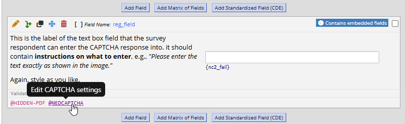
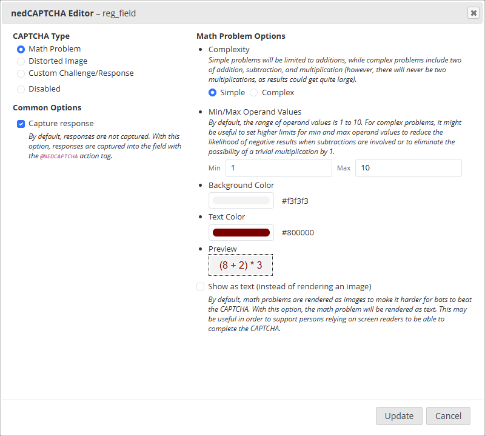

# nedCAPTCHA 2 (REDCap External Module)

[](https://doi.org/10.5281/zenodo.20492803)

nedCAPTCHA 2 adds CAPTCHA protection to REDCap public surveys without depending on an external CAPTCHA provider. The name stands for **n**o **e**xternal **d**ependencies.

This is a new version of [nedCAPTCHA](https://github.com/grezniczek/redcap_nedcaptcha). It uses action-tagged fields on the first survey page instead of a fixed module-level CAPTCHA page, which allows more project-specific layout, field embedding, and compatibility with REDCap Multi-Language Management.

## Purpose

REDCap 8.11.0 and newer can use Google reCAPTCHA, but that is not always suitable for servers with restrictive firewall rules, strict privacy requirements, or policies that prohibit sharing respondent IP addresses with a third-party CAPTCHA service. nedCAPTCHA 2 keeps the challenge generation inside REDCap/PHP.

## Effect

When the module is enabled in a project and an instrument's first public survey page contains an `@NEDCAPTCHA` field, respondents must solve the configured challenge before the normal first survey page is shown. The module supports:

- a simple or complex math problem,
- a distorted text image,
- a custom challenge-response list, or
- a disabled `none` mode that leaves the tagged fields out of normal survey operation without presenting a challenge.

In longitudinal projects, the CAPTCHA applies to the public link for each eligible arm. Each link has its own challenge proof. Individual participant links remain under REDCap’s control.

The module stores transient CAPTCHA state in the External Modules log and binds each challenge to the browser's REDCap survey session. Challenge proof expires 120 minutes after issuance; an hourly cron removes expired log entries. CAPTCHA responses are not saved to the project data unless the **Capture response** option is enabled.


The custom challenge type can also be used as lightweight public-survey password protection by configuring one challenge such as `Type the access key to proceed. = secretaccesskey`. This applies to normal public entry; REDCap's individual-link workflows remain governed by REDCap.

## Requirements

- REDCap 15.5.0 or newer.
- REDCap External Modules Framework 16 or newer.
- Browser cookies that allow REDCap's survey session to persist across requests.
- PHP GD with FreeType support for image rendering. If image rendering is unavailable, the module uses a plain-text math puzzle.

## Installation

- Download a version from [GitHub Releases](https://github.com/grezniczek/nedcaptcha2/releases) and extract it to `<redcap-root>/modules/nedcaptcha2_v<version-number>` with `config.json` directly inside that folder. You can also install it from the REDCap Consortium External Modules Repo when available.
- For a development checkout, retain the directory name `nedcaptcha2_v9.9.9`; this directory convention is independent of published release versions.
- In REDCap, go to _Control Center > Technical / Developer Tools > External Modules_ and enable **nedCAPTCHA 2**.
- Enable the module in projects that need public survey CAPTCHA protection.

An importable REDCap demo project is available at [example/Demo_nedCAPTCHA2.REDCap.xml](example/Demo_nedCAPTCHA2.REDCap.xml).

## Configuration

There are no system-level settings besides the standard External Modules Framework controls.

Project-level settings:

- **Debug mode:** Available to super users. When enabled, nedCAPTCHA 2 prints diagnostic information to the browser console and includes the answer in math challenges for troubleshooting.
- **Allow solved CAPTCHA sessions:** When enabled, a browser that has solved the CAPTCHA may reuse that solved state for the same project's public survey without solving again in a new tab.
- **Solved CAPTCHA session timeout:** Number of minutes a solved session remains valid. The default is 120 minutes. Use `0` for no configured timeout; sessions are still capped at 24 hours and expire after 2 hours without refresh.

All CAPTCHA behavior is configured through the `@NEDCAPTCHA` action tag. In the Online Designer, click the `@NEDCAPTCHA` action tag on the field list to open the nedCAPTCHA Editor. Manual JSON editing is possible, but the editor is the recommended way to maintain settings. The JSON configuration format is described by [schema/nedcaptcha-action-tag.schema.json](schema/nedcaptcha-action-tag.schema.json).

A bare `@NEDCAPTCHA` action tag uses the default math CAPTCHA on the survey and opens the editor with **Math Problem** selected.

The editor requires design rights. In production projects, configuration changes require editable draft mode and are written to draft metadata. Successful changes are recorded in the REDCap project log with the field, metadata table, and before/after configuration; custom responses are redacted because they may be access keys.

Save errors and warnings appear inside the editor. If settings are edited while a save is pending, the editor keeps the later changes open and requests another Update.

If loading settings fails because design rights or editable draft mode have changed, the editor shows the server's explanation in a closeable error dialog with no Update button. Failed requests and malformed replies also show an error instead of an empty editor. Resolve the issue and reload the Online Designer before trying again. Recoverable configuration warnings appear alongside valid settings so they can be corrected and saved.





## Basic Setup

1. Put a Text Box field with no validation on the first page of the public survey instrument. If all questions are displayed on one page, the field can be in any section. If each section is displayed on a separate page, the field must be in the first section.
2. Add `@NEDCAPTCHA` to that field.
   The editor link appears as soon as the Online Designer updates the field row, including the first tagged field on an instrument.
3. Use the field label as the prompt shown above the challenge.
4. Click the action tag in the Online Designer to configure the CAPTCHA type and options.
5. Consider adding `@HIDDEN-FORM` and `@HIDDEN-PDF` to fields used only for the CAPTCHA page, especially when the response is not captured.

The `@NEDCAPTCHA` field and other nedCAPTCHA helper fields are removed from normal survey operation after the respondent passes the CAPTCHA, or when the module determines that the current request is not the fresh public survey entry point.

## Action Tags

All nedCAPTCHA action tags are case-sensitive and must use the uppercase names shown below.

### `@NEDCAPTCHA`

Required to protect a public survey. Add it to one Text Box field without validation on the first survey page. The action tag accepts a JSON object containing the CAPTCHA configuration.

Only one `@NEDCAPTCHA` field should be used on a survey page.

Example math configuration:

```text
@NEDCAPTCHA={
  "type": "math",
  "complexity": "complex",
  "minValue": 2,
  "maxValue": 12,
  "showAsText": true
}
```

Example custom challenge-response configuration:

```text
@NEDCAPTCHA={
  "type": "custom",
  "caseInsensitive": true,
  "custom": [
    {
      "challenge": "The color of the sky?",
      "response": "blue"
    },
    {
      "challenge": "Type the access key to proceed.",
      "response": "secretaccesskey"
    }
  ]
}
```

### `@NEDCAPTCHA-INSTRUCTIONS`

Optional. Add it to a Descriptive Text field on the first survey page. While the CAPTCHA is shown, this field's label replaces the normal survey instructions. This is useful for custom intro text and for REDCap Multi-Language Management.

Only one `@NEDCAPTCHA-INSTRUCTIONS` field should be used.

### `@NEDCAPTCHA-FAILMESSAGE`

Optional. Add it to a Descriptive Text field on the first survey page. The field is hidden initially and shown only after an incorrect CAPTCHA response.

Only one `@NEDCAPTCHA-FAILMESSAGE` field should be used.

### `@NEDCAPTCHA-DISPLAY`

Optional. Add it to Descriptive Text fields on the first survey page that should remain visible while the CAPTCHA is presented. This can be used for logos, explanatory text, or other content that belongs on the CAPTCHA screen.

This tag may be used on multiple fields.

### `@NEDCAPTCHA-CUSTOM-CHALLENGE`

Optional and only relevant when the CAPTCHA type is `custom`. Add it to a Text Box field without validation on the first survey page. The module writes the selected custom challenge value into this field and triggers branching logic, which allows you to show custom fields or images based on the selected challenge.

Only one `@NEDCAPTCHA-CUSTOM-CHALLENGE` field should usually be used.

### `@NEDCAPTCHA-CUSTOM-EMBED`

Optional and only relevant when the CAPTCHA type is `custom`. Add it to a field on the first survey page with one string parameter matching a custom challenge value, for example:

```text
@NEDCAPTCHA-CUSTOM-EMBED="challenge_a"
```

When that challenge is selected, the matching field's label is embedded where the CAPTCHA challenge normally appears. Non-matching embed fields are excluded from the CAPTCHA page. Do not combine this tag with other nedCAPTCHA action tags on the same field.

This tag may be used on multiple fields.

## CAPTCHA Options

### Common Options

- **CAPTCHA Type:** `math`, `image`, `custom`, or `none`.
- **Capture response:** Enable this option to save the verified answer in the `@NEDCAPTCHA` field with the first survey submission, including Save & Return Later. The module holds the answer server-side until REDCap saves the survey. A capture failure leaves the survey submission intact. When a Stop Action saves the survey, REDCap writes the verified answer with the stop choice, including on e-Consent surveys. Capture is off by default.

### Math Problem

- **Complexity:** `simple` uses addition. `complex` uses two operators selected from addition, subtraction, and multiplication. The generator avoids double multiplication and non-negative results are enforced.
- **Minimum / Maximum operand values:** Positive integer bounds for initially generated operands. The defaults are 1 and 10, and the minimum must not exceed the maximum. The editor rejects an inverted range; an existing hand-written inverted range is normalized to 1 through 10 at runtime. Subtraction problems can enlarge an operand to keep the result non-negative.
- **Show as text:** By default, math challenges are rendered as images. This option renders the math expression as text, which may improve accessibility for screen-reader users.
- **Background color / Text color:** Colors may be entered as HTML hex values such as `#ff0000` or as comma-separated RGB triplets such as `255,0,0`.

### Distorted Text Image

- **Length:** Number of characters in the generated challenge. The allowed range is 3 to 8 characters; the default is 5.
- **Re-use challenge:** By default, a new image challenge is created after an unsuccessful attempt. When enabled, the same challenge is reused for retries.
- **Angle variation:** `none`, `slight`, `medium`, or `strong`.
- **Size variation:** `none`, `slight`, `medium`, or `strong`.
- **Noise density:** `off`, `low`, `medium`, or `high`.
- **Background color / Text color / Noise color:** Colors may be entered as HTML hex values or comma-separated RGB triplets.

The image character set is optimized for readability and excludes visually ambiguous characters.

### Custom Challenge/Response

Enter one challenge-response pair per line, separated by `=`:

```text
The color of the sky? = blue
The color of grass? = green
Snow White and the __?__ dwarfs = seven
```

If a stored challenge contains an equals sign, or a pair contains line breaks or surrounding whitespace, the editor shows the pairs as a JSON list so their exact text can be edited. Changing another setting preserves the original pairs.

The module randomly selects one pair. Challenges are displayed as escaped plain text; use `@NEDCAPTCHA-CUSTOM-EMBED` with descriptive fields for formatted content or images. JSON string parameters for embedding keys are decoded, so escaped quotes, backslashes, and Unicode escapes can match the challenge text.

Leading and trailing whitespace is trimmed from responses. Otherwise, custom responses are compared as text: leading zeros are significant, and scientific-notation strings are not treated as equivalent numbers. By default, comparison is case-sensitive. Enable **Use case-insensitive comparison for responses** to accept answers regardless of case. The custom helper fields are optional.

## Styling

The module injects a small number of wrapper elements that can be targeted from custom survey CSS:

- Instructions from `@NEDCAPTCHA-INSTRUCTIONS` are wrapped in `#nedcaptcha2-instructions`.
- Challenges are wrapped in `.nedcaptcha2-challenge`.
- Failed responses cause the response input to receive a red outline and an inline warning icon.

For example:

```css
#nedcaptcha2-instructions {
  margin-bottom: 1rem;
}

.nedcaptcha2-challenge {
  font-size: 1.2rem;
}
```

## Notes and Limitations

- The module is intended for the first page of a fresh public survey. It does not protect data-entry forms, authenticated survey links tied to existing records, returning surveys, survey queue passthroughs, or end-of-survey/return-code flows.
- REDCap's private-link workflows, including participant-link issuance, are outside the intended CAPTCHA scope. A link issued by REDCap is handled as an individual survey link; nedCAPTCHA does not provide an access-control boundary around REDCap's issuance of such links.
- Calculated fields are not evaluated while the CAPTCHA-only page is displayed. Normal calculation behavior resumes after the CAPTCHA is passed. Branching logic remains available for `@NEDCAPTCHA-CUSTOM-CHALLENGE`; logic used on the CAPTCHA-only page should reference fields retained on that page.
- The Save & Return Later button is hidden while the CAPTCHA is being presented.
- A CAPTCHA is valid for two hours from issuance. If it expires or the browser loses its survey session before the first save, the respondent is asked to solve another CAPTCHA. REDCap then resumes the submission, including Save & Return Later or a confirmed Stop Action. REDCap uses the survey’s Stop Action setting to save or discard the response and displays the configured acknowledgement.
- During recovery, the browser’s current server-side survey session holds eligible first-page answers for up to two hours. If the original upload session was also lost, the survey restores the other answers and highlights files to upload again before submitting.
- Custom challenges and responses must be nonblank strings. The survey skips invalid pairs and falls back to math if none remain. Invalid colors use the default for that color and produce a warning.
- Unparseable action-tag parameters and missing or invalid CAPTCHA types fall back to a math challenge, with a diagnostic warning. Disabling protection requires the explicit configuration `"type": "none"`. The editor opens recognizable malformed assignments with math defaults and replaces the whole value on Update. If unfinished quotes or surrounding notes make the end of the assignment unclear, correct it in the field annotation; the editor explains the problem and leaves the annotation intact. Invalid editor submissions are rejected without changing metadata.
- If CAPTCHA generation or image rendering fails, the module falls back to a plain-text math puzzle so that respondents can still reach the survey.
- Solved CAPTCHA sessions are disabled by default. When disabled, opening the same public survey in a new tab requires solving the CAPTCHA again.
- When solved CAPTCHA sessions are enabled, the solved state is stored as an opaque browser cookie backed by server-side session metadata. It applies only to the same browser and the same project public survey.

## Release history

See the [changelog](CHANGELOG.md) for changes by version.

## How to Cite This Work

If you use this external module for a project that generates a research output, please cite this software in addition to [citing REDCap](https://projectredcap.org/resources/citations/).

Select **Cite this repository** on GitHub for citation formats generated from [CITATION.cff](CITATION.cff). The [Zenodo archive](https://doi.org/10.5281/zenodo.20492803) covers all versions. To cite a particular release, use the DOI on that version’s Zenodo record.
